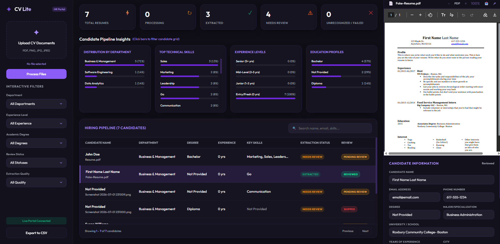

# CV Lite — AI Resume Screening Dashboard

An AI-assisted resume processing and candidate management prototype built using Python, FastAPI, OCR, LLM APIs, and SQLite.

This repository is a portfolio showcase. The complete source code and internal configurations are not publicly available.

## Overview

CV Lite is designed to help recruitment teams process resumes, extract candidate information, organize applicant records, and review recruitment analytics through an interactive dashboard.

## Key Features

- Batch resume uploads (PDF, PNG, JPG, JPEG)
- PDF text extraction and OCR
- LLM-based structured information extraction
- Rule-based fallback when AI extraction is unavailable
- Candidate department suggestions
- Candidate search and filtering
- Manual candidate review and status updates
- Recruitment analytics and visualizations
- Real-time processing updates using Server-Sent Events
- CSV export functionality

## Technologies

- Python
- FastAPI
- SQLite
- JavaScript
- HTML & CSS
- Tesseract OCR
- LLM APIs
- Server-Sent Events (SSE)

## Dashboard Preview

The dashboard displays candidate processing status, recruitment insights, applicant records, and resume previews.

## Processing Workflow

Resume Upload → PDF/OCR Text Extraction → AI & Rule-Based Extraction → Structured Candidate Data → SQLite Storage → Review Dashboard

## Privacy & Implementation

This repository is intended for portfolio and demonstration purposes.

The complete application source code, API credentials, internal configurations, and candidate data are not publicly distributed.

The dashboard preview uses demonstration data and does not represent a production recruitment deployment.

## Author

**Bandar Farhan**

[GitHub](https://github.com/bandar-farhan) | [LinkedIn](https://www.linkedin.com/in/bandar-farhan)
